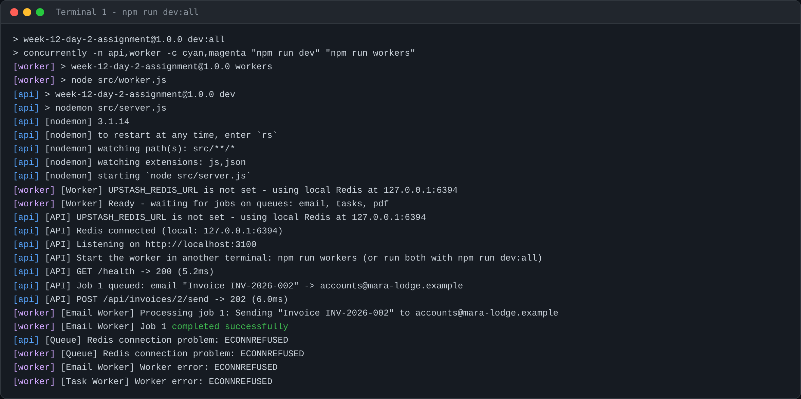
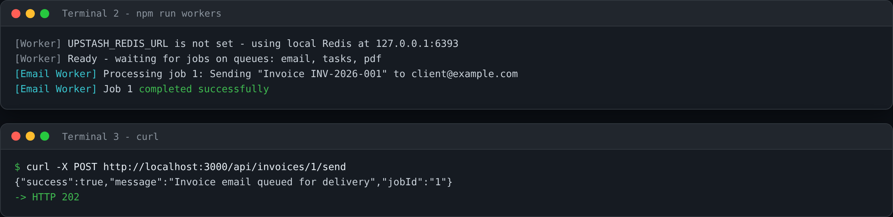
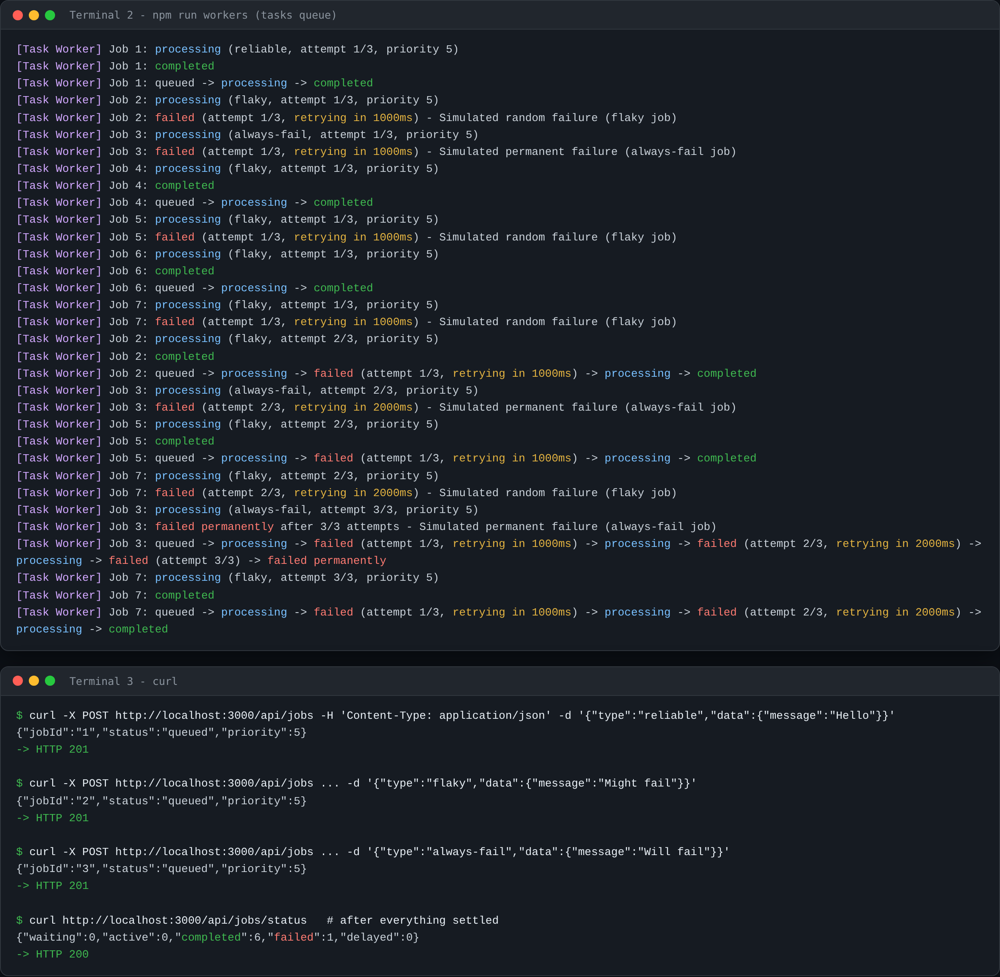
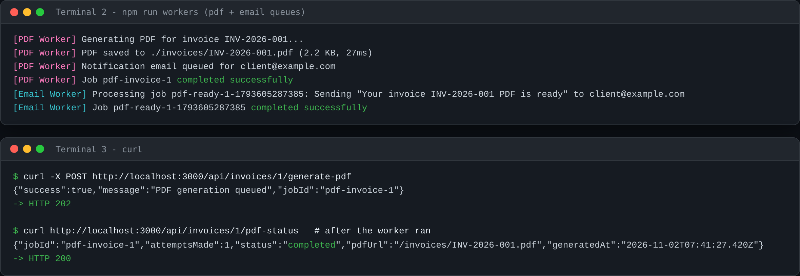
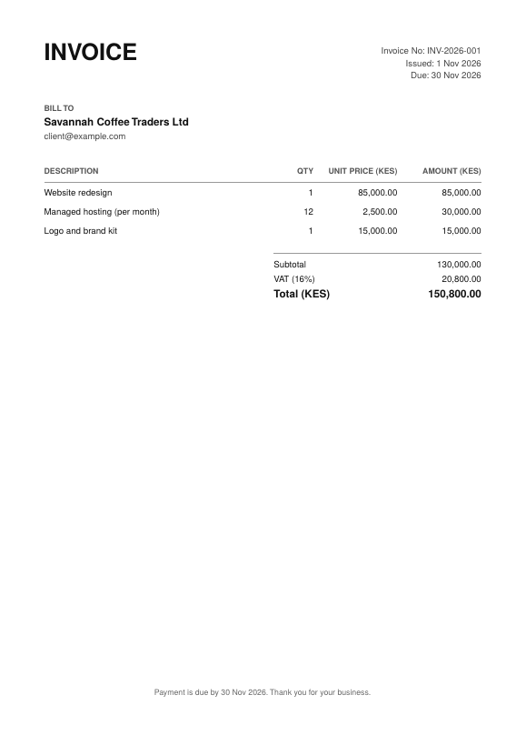
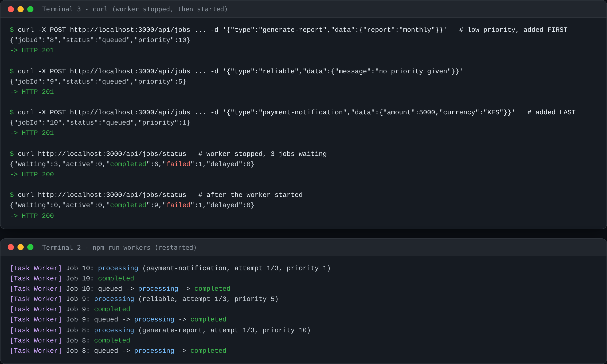

# Week 12 Day 2 – Background Jobs

An Express API that moves slow work into background jobs with **BullMQ** and Redis (Upstash). The API only queues jobs and answers immediately; a **separate worker process** does the work.

1. **Email queue** – `POST /api/invoices/:id/send` returns `202` at once; the worker "sends" the email (500 ms simulated)
2. **Job queue with retries** – `tasks` queue, 3 attempts, exponential backoff, `flaky` / `always-fail` test jobs, queue statistics
3. **PDF generation job** – PDFKit invoice (16% VAT, KES) saved to `./invoices/`, then a notification email job is queued
4. **Bonus: job priorities** – `payment-notification` = 1, `generate-report` = 10, everything else defaults to 5

## Setup

```bash
npm install
cp .env.example .env     # then put your Upstash URL in .env
npm run dev:all          # API (nodemon) + worker, in one terminal
```

`.env`:

```bash
PORT=3000
UPSTASH_REDIS_URL=rediss://default:<password>@<endpoint>.upstash.io:6379
```

While `UPSTASH_REDIS_URL` is still the placeholder, the app uses `REDIS_URL` or a local Redis at `redis://127.0.0.1:6379` and says so at startup.

| Script | What it does |
| --- | --- |
| `npm run dev` | API with nodemon (`src/server.js`) |
| `npm run workers` | Worker process (`src/worker.js`) |
| `npm run dev:all` | Both, with `[api]` / `[worker]` prefixes |
| `npm test` | 53 tests against a real `redis-server` (skipped if not installed) |

The worker is always a separate process from the API. You can run them in two terminals or with `dev:all`.



## Endpoints

| Method | Path | Notes |
| --- | --- | --- |
| POST | `/api/invoices/:id/send` | Queue the invoice email → `202` |
| POST | `/api/invoices/:id/generate-pdf` | Queue PDF generation → `202` |
| GET | `/api/invoices/:id/pdf-status` | `queued` / `in_progress` / `completed` / `failed` |
| POST | `/api/jobs` | `{ type, data, priority? }` → `201 { jobId, status }` |
| GET | `/api/jobs/status` | `{ waiting, active, completed, failed, delayed }` (`?queue=email\|pdf` for the others) |
| GET | `/api/jobs/:id` | One job in the `tasks` queue |
| GET | `/invoices/<number>.pdf` | Generated PDFs |
| GET | `/api/invoices`, `/api/invoices/:id`, `/health` | Helpers |

Five invoices are seeded in memory (`src/data/invoices.js`); invoice 1 is `INV-2026-001` for `client@example.com`.

---

## Task 1 – Email in a background queue

```bash
curl -X POST http://localhost:3000/api/invoices/1/send
```

```text
{"success":true,"message":"Invoice email queued for delivery","jobId":"1"}
-> HTTP 202
```

API terminal: `[API] Job 1 queued: email "Invoice INV-2026-001" -> client@example.com`

Worker terminal:

```text
[Worker] Ready - waiting for jobs on queues: email, tasks, pdf
[Email Worker] Processing job 1: Sending "Invoice INV-2026-001" to client@example.com
[Email Worker] Job 1 completed successfully
```



The connection is parsed from `UPSTASH_REDIS_URL` by `parseRedisUrl()` in `src/jobs/queue.js`.

## Task 2 – Retries with exponential backoff

`tasks` queue defaults: `attempts: 3`, `backoff: { type: 'exponential', delay: 1000 }`, `removeOnComplete: { count: 100 }`, `removeOnFail: { count: 500 }`. The worker runs one job at a time.

```bash
curl -X POST http://localhost:3000/api/jobs -H "Content-Type: application/json" \
  -d '{"type":"reliable","data":{"message":"Hello"}}'
# {"jobId":"1","status":"queued","priority":5}        -> HTTP 201

curl -X POST http://localhost:3000/api/jobs -H "Content-Type: application/json" \
  -d '{"type":"flaky","data":{"message":"Might fail"}}'
# {"jobId":"2","status":"queued","priority":5}        -> HTTP 201

curl -X POST http://localhost:3000/api/jobs -H "Content-Type: application/json" \
  -d '{"type":"always-fail","data":{"message":"Will fail"}}'
# {"jobId":"3","status":"queued","priority":5}        -> HTTP 201

curl http://localhost:3000/api/jobs/status
# {"waiting":0,"active":0,"completed":6,"failed":1,"delayed":0}   -> HTTP 200
```

Worker terminal (job 2 is flaky, job 3 always fails; four more flaky jobs were queued so retries show up):

```text
[Task Worker] Job 1: queued -> processing -> completed
[Task Worker] Job 2: queued -> processing -> failed (attempt 1/3, retrying in 1000ms) -> processing -> completed
[Task Worker] Job 3: queued -> processing -> failed (attempt 1/3, retrying in 1000ms) -> processing -> failed (attempt 2/3, retrying in 2000ms) -> processing -> failed (attempt 3/3) -> failed permanently
```

Every transition is also logged as its own line (`processing (flaky, attempt 2/3)`, `failed (attempt 2/3, retrying in 2000ms) - <error>`, `failed permanently after 3/3 attempts`), see the screenshot:



With `attempts: 3` there are two retries, so only the 1 s and 2 s delays are ever used (the 4 s step would apply to a fourth attempt).

## Task 3 – PDF generation job

```bash
curl -X POST http://localhost:3000/api/invoices/1/generate-pdf
# {"success":true,"message":"PDF generation queued","jobId":"pdf-invoice-1"}   -> HTTP 202

curl http://localhost:3000/api/invoices/1/pdf-status
# {"jobId":"pdf-invoice-1","attemptsMade":1,"status":"completed","pdfUrl":"/invoices/INV-2026-001.pdf","generatedAt":"2026-11-02T07:41:27.420Z"}
```

Worker terminal:

```text
[PDF Worker] Generating PDF for invoice INV-2026-001...
[PDF Worker] PDF saved to ./invoices/INV-2026-001.pdf (2.2 KB, 27ms)
[PDF Worker] Notification email queued for client@example.com
[PDF Worker] Job pdf-invoice-1 completed successfully
[Email Worker] Processing job pdf-ready-1-1793605287385: Sending "Your invoice INV-2026-001 PDF is ready" to client@example.com
[Email Worker] Job pdf-ready-1-1793605287385 completed successfully
```



The job payload holds `invoiceId`, client name, line items (description, quantity, unit price), subtotal, 16% VAT amount, total in KES and due date. The notification email contains the download URL (`PUBLIC_BASE_URL` + `/invoices/INV-2026-001.pdf`). A sample output is in [`docs/sample-INV-2026-001.pdf`](docs/sample-INV-2026-001.pdf):



## Bonus – Job priorities

`payment-notification` is always queued with priority 1, `generate-report` always with 10 (a client cannot override either); any other job uses the `priority` you send (integer 1–10) or **5**. The worker was stopped, the report was queued first and the payment notification last, then the worker was started:

```text
[Task Worker] Job 10: processing (payment-notification, attempt 1/3, priority 1)
[Task Worker] Job 9: processing (reliable, attempt 1/3, priority 5)
[Task Worker] Job 8: processing (generate-report, attempt 1/3, priority 10)
```



---

## Bugs found while reviewing and how they were fixed

- **Jobs without a priority jump the queue.** In BullMQ a job with no priority is processed *before* every prioritized job (verified: order was `none > high > mid > low`), which would have broken the bonus. Jobs that don't ask for a priority now get 5.
- **`waiting` hid prioritized jobs.** BullMQ counts prioritized jobs in a separate state, so `/api/jobs/status` showed `waiting: 0` with jobs queued. `waiting` now adds prioritized and paused jobs.
- **BullMQ 6 removed `queue.client`.** The Redis health check used it, so `/health` always said "down" and startup warned wrongly. It now uses a public BullMQ call.
- **API hangs when Redis is down.** Producer connections are fail-fast (`enableOfflineQueue: false`), so the API answers `503` with `Retry-After` in milliseconds instead of hanging, and nothing is replayed later (which would send an email the user was told had failed). It recovers when Redis returns.
- **`parseRedisUrl` and passwords.** `URL.password` stays percent-encoded, so a password containing `@`, `:` or `/` would fail to authenticate. Credentials are decoded; IPv6 hosts are handled; errors never include the URL (it contains the password).
- **PDF edge cases.** Files are written under a dot-name and renamed when complete, so a half-written PDF is never served; regenerating works (a finished job no longer blocks a new one); asking twice while one is running returns the same job; an invalid payload fails once instead of being retried; a retried PDF job cannot send the notification twice, but regenerating notifies again.
- **Worker shutdown.** `SIGINT`/`SIGTERM` finish running jobs before exiting, with a 10 s forced exit because BullMQ cannot close a worker whose Redis is gone.

## Tests

`npm test` runs 53 tests (Node's test runner, real `redis-server`, no mocks for Redis):

- `test/unit.test.js` – URL parsing, config, priority rules, backoff maths, VAT totals, PDF rendering
- `test/api.test.js` – every endpoint with queues but no worker, plus the Redis-down `503` and recovery
- `test/workers.test.js` – full lifecycles, retries and timings, sequential processing, priority order, PDF end to end, graceful shutdown

